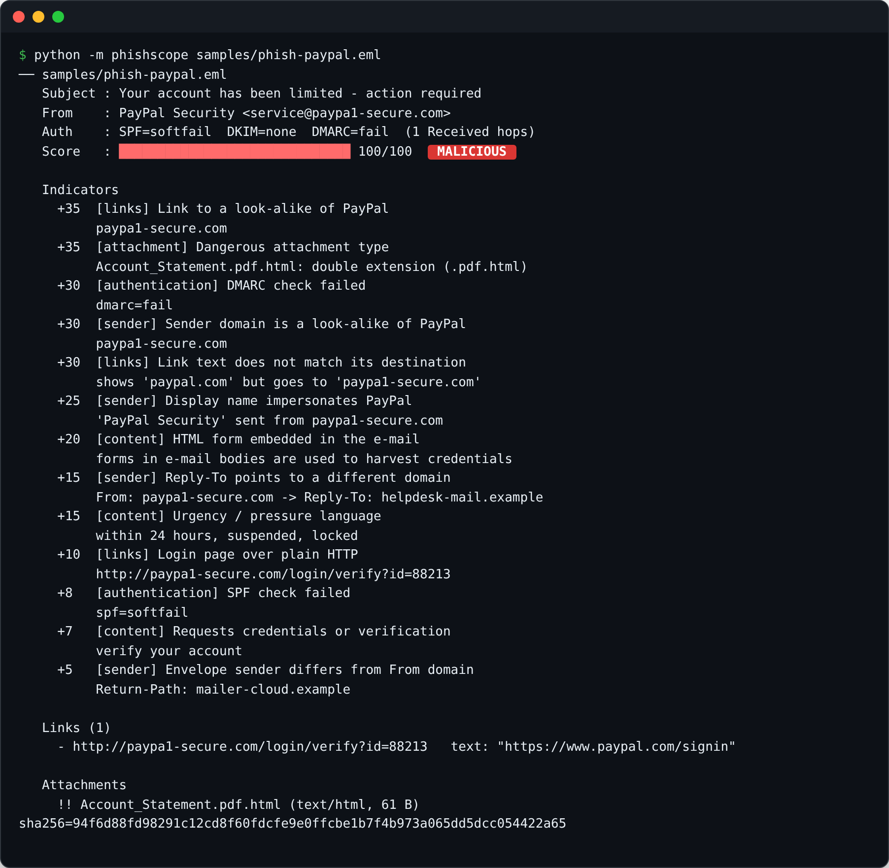
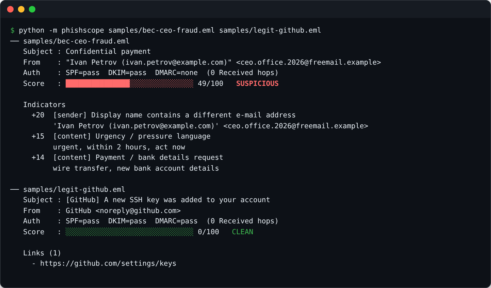

<h1 align="center">phishscope</h1>

<p align="center">
  <b>Static phishing analysis for suspicious e-mails (.eml)</b><br>
  Explains <i>why</i> a message is dangerous: authentication results, look-alike domains, deceptive links, risky attachments and social-engineering language — in English and Russian.
</p>

<p align="center">
  
  
  
  
  
</p>

<p align="center"></p>

## What it does

A SOC analyst triaging a reported e-mail answers the same questions every time: *Did authentication pass? Is the sender who they claim to be? Where do the links really go? Is the attachment dangerous?* `phishscope` answers them in one second and produces IOCs ready for blocking.

It is **completely static** — it never follows links or opens attachments — so it is safe to run on live samples.

| Category | Checks |
|---|---|
| **Authentication** | SPF / DKIM / DMARC verdicts from `Authentication-Results` and `Received-SPF` |
| **Sender identity** | Reply-To and Return-Path domain mismatch · e-mail address hidden in the display name · brand impersonation in the display name (incl. Russian brand names: Сбербанк, Госуслуги, Яндекс…) |
| **Look-alike domains** | typosquatting (`paypa1.com`), homoglyphs and punycode (`pаypal.com` with a Cyrillic `а`), brand-with-decoration (`sberbank-bonus.ru`), brand-as-subdomain (`paypal.com.account-check.net`) |
| **Links** | anchor text vs real destination · raw IP URLs · `user@host` URL trick · URL shorteners · login pages over plain HTTP |
| **Content** | urgency and pressure, credential / one-time code requests, payment and bank-detail changes (BEC) — EN + RU patterns · HTML forms inside the e-mail |
| **Attachments** | executable and macro formats · double extensions (`invoice.pdf.exe`) · RTL-override filenames · archives · SHA-256 for every file |

Every indicator has a weight; the sum (capped at 100) gives a verdict: `clean` < 15 ≤ `caution` < 40 ≤ `suspicious` < 70 ≤ `malicious`.

## Quick start

```bash
git clone https://github.com/Sashagran/phishscope.git
cd phishscope

python -m phishscope samples/                          # analyze a folder
python -m phishscope suspicious.eml --format json       # machine-readable, includes IOCs
python -m phishscope suspicious.eml --format markdown   # paste into a ticket / incident report
```

Exit code `2` when any message scores above `--threshold` (default 40) — handy for mail-gateway hooks and scripts.

<details>
<summary><b>Business e-mail compromise vs. a legitimate notification</b></summary>
<p align="center"></p>
</details>

<details>
<summary><b>Markdown report for an incident ticket (Russian bank phishing)</b></summary>

| Weight | Category | Indicator | Details |
|---:|---|---|---|
| +30 | authentication | DMARC check failed | dmarc=fail |
| +30 | sender | Sender domain is a look-alike of Sberbank | sberbank-bonus.ru |
| +25 | sender | Display name impersonates Sberbank | 'Сбербанк Онлайн' sent from sberbank-bonus.ru |
| +25 | links | Link points to a raw IP address | http://198.51.100.17/sber/login |
| +20 | content | Requests credentials or verification | подтвердите личност, код из SMS, введите данные карты |
| +15 | authentication | SPF check failed | spf=fail |
| +15 | content | Urgency / pressure language | Срочно, в течение 2 час, заблокирован |
| +10 | links | URL shortener hides the destination | https://clck.ru/3AbCdE |

</details>

## Samples

[`samples/`](samples) contains four synthetic messages built by [`generate_samples.py`](samples/generate_samples.py) (fictional people, reserved domains and documentation IPs):

| File | Scenario | Verdict |
|---|---|---|
| `phish-paypal.eml` | Credential phishing: look-alike domain, deceptive link, embedded form, `.pdf.html` attachment | malicious (100) |
| `phish-bank-ru.eml` | Russian-language bank phishing with a shortener and an IP link | malicious (100) |
| `bec-ceo-fraud.eml` | CEO fraud: spoofed display name, urgent wire transfer, passes SPF/DKIM | suspicious (49) |
| `legit-github.eml` | Genuine security notification | clean (0) |

The BEC case is the interesting one: SPF and DKIM **pass**, because the attacker uses their own free-mail domain. Only identity and content analysis catches it.

## Design

```text
.eml ─► email.parser ─► headers ──► authentication / sender identity checks ─┐
                     ├► text + HTML bodies ─► link extractor ─► link checks ─┤
                     │                     └► EN/RU language patterns ───────┼─► weighted indicators ─► score + verdict + IOCs
                     └► attachments ─► type / extension checks + SHA-256 ────┘
```

- Pure standard library (`email`, `html.parser`, `ipaddress`) — no network access, no dependencies
- Look-alike detection uses homoglyph normalization + Levenshtein distance against a brand list, with no external public-suffix download
- Indicators are data, not prints: the same result renders as text, JSON or Markdown

## Tests

```bash
python -m unittest discover -s tests -v
```

Covers look-alike detection (including false-positive guards like `ozone.ru`, `applebees.com`, `s3.amazonaws.com`), each indicator family, Russian-language patterns, sample verdicts and CLI exit codes.

## Limitations

Heuristic scoring is a triage aid, not a final verdict: always confirm with sandbox detonation and threat intelligence. Archive contents and attachment internals (macros, PDF JavaScript) are not inspected yet.

## License

MIT © Alexander Zheltov
